# Modèle de données

```mermaid
classDiagram
    direction LR
    class City { id; name «unique»; region; latitude; longitude }
    class User { id; email «unique»; password; roles; firstName; lastName; phone; driverCancellations }
    class Vehicle { id; make; model; color; plate «unique»; seats }
    class Trip { id; status; seatsTotal; ratePerKm; routeGeometry; note; publish(); cancel(); complete(); availableSeats(from,to) }
    class TripStop { id; position; arrivalAt; departureAt; meetingPoint }
    class TripLeg { id; position; distanceKm; priceMad; capacity; seatsTaken; remaining(); take(n); release(n) }
    class Booking { id; reference «unique»; seats 1..4; totalPriceMad; status; createdAt; cancelledAt; cancel(by); complete() }
    class Payment { id; amountMad; refundedMad; status; refund(ratio) }
    class Review { id; role; rating 1..5; comment; createdAt }

    User "1" --> "*" Vehicle : possède
    User "1" --> "*" Trip : conduit
    Vehicle "1" --> "*" Trip : utilisé par
    Trip "1" *-- "2..*" TripStop : arrêts ordonnés
    Trip "1" *-- "1..*" TripLeg : tronçons
    City "1" --> "*" TripStop
    TripStop "1" --> "*" TripLeg : départ / arrivée
    Trip "1" --> "*" Booking
    User "1" --> "*" Booking : passager
    TripStop "1" --> "*" Booking : montée / descente
    Booking "1" -- "1" Payment
    Trip "1" --> "*" Review
    User "1" --> "*" Review : auteur / destinataire
```

Services (hors persistance) : `BookingService` (réserver, annuler passager / conducteur), `CancellationPolicy`
(taux de remboursement, droits d'annulation), `PricingService` (prix d'un tronçon / d'une portion),
`ReviewPolicy` + `ReviewService` (qui peut noter qui), `TripService` (création, clôture),
`GeoService` (Nominatim / OSRM), `TripLocker` (verrou et transactions).

## Écarts par rapport au diagramme de conception initial
- `TripStatus` gagne l'état `DRAFT` : sans lui, `Trip::publish()` n'aurait aucun sens. `TripService::create()` publie immédiatement.
- `Review.role` désigne le rôle de la personne **notée** (conducteur ou passager), pas celui de l'auteur.
- Le passager n'est pas un rôle Symfony : un utilisateur est « conducteur » dès qu'il possède un véhicule (`User::isDriver()`), donc une même personne est les deux sans configuration.
- Table `app_user` (et non `user`) pour éviter le mot réservé.

## Pourquoi des tronçons (`TripLeg`) ?
Un trajet Agadir → Essaouira → Marrakech a deux tronçons. Une réservation « Essaouira → Marrakech » occupe uniquement le
second. Le nombre de places libres d'une portion est le **minimum** des places libres de ses tronçons ; un passager qui
descend à Essaouira libère donc automatiquement sa place pour la suite du trajet. Les compteurs vivent dans la base, avec une
contrainte `CHECK (seats_taken BETWEEN 0 AND capacity)` comme dernier filet de sécurité.
